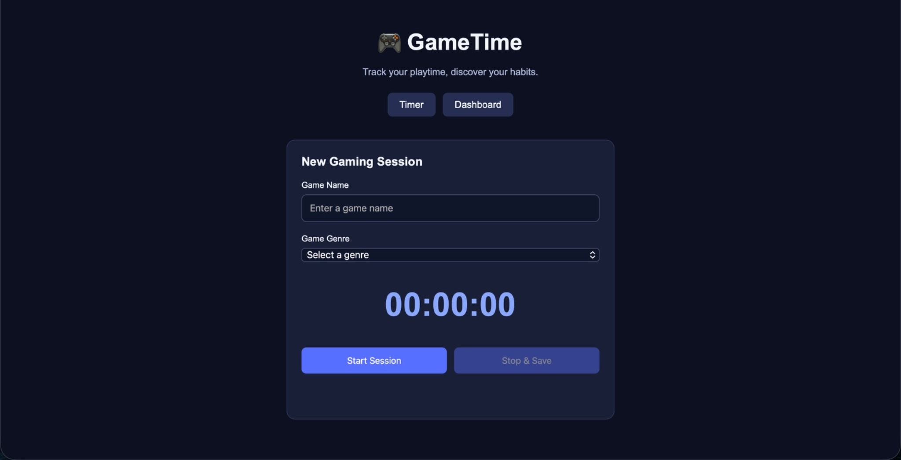
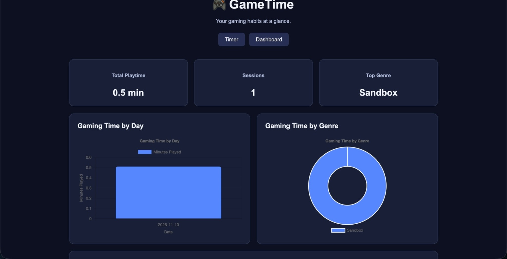
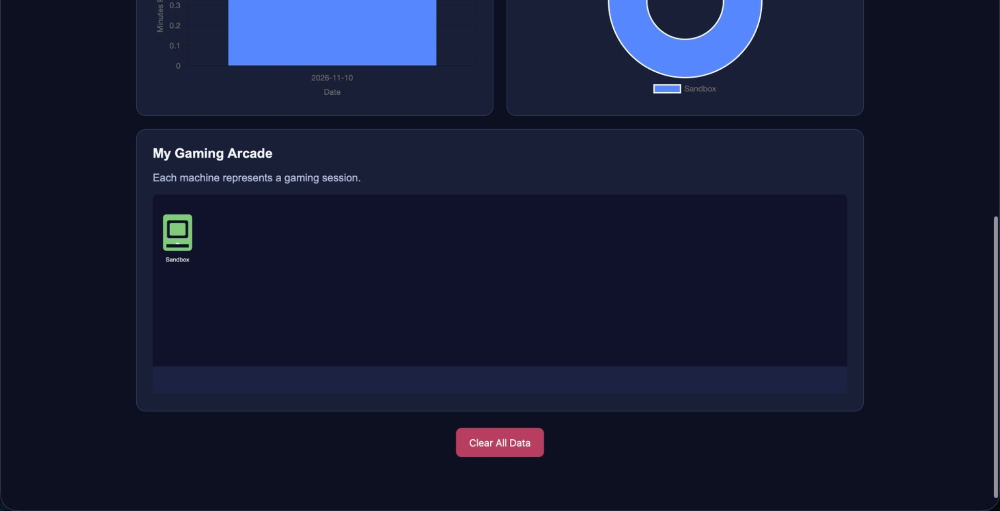
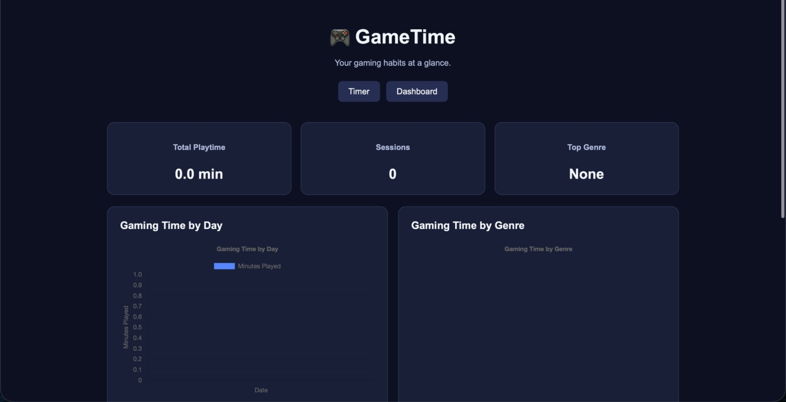
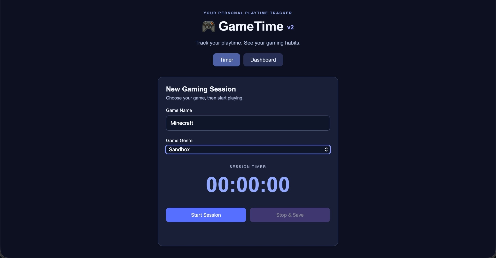
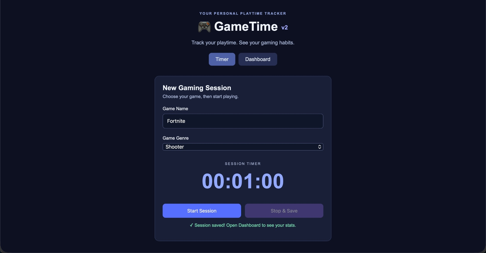
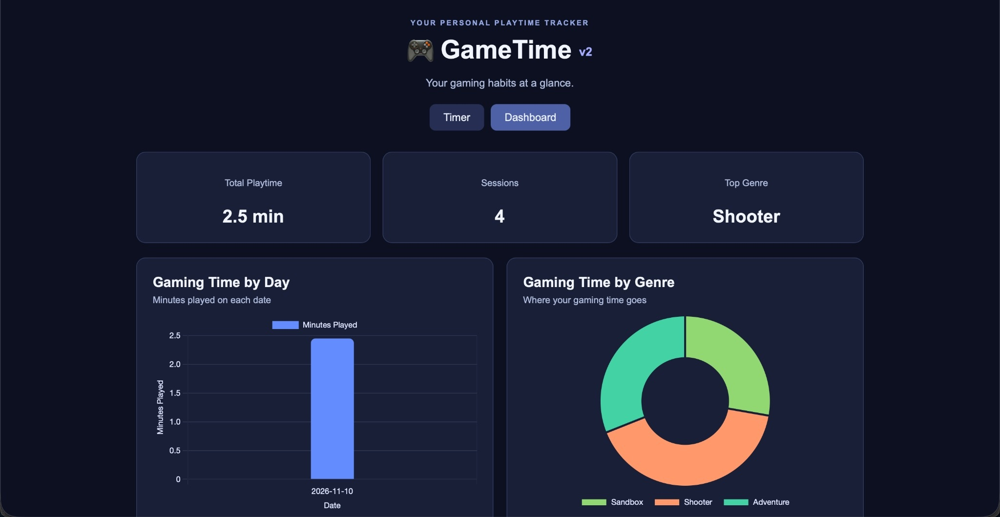
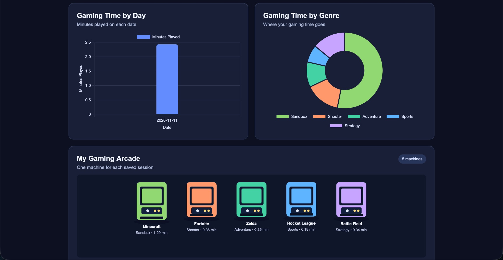
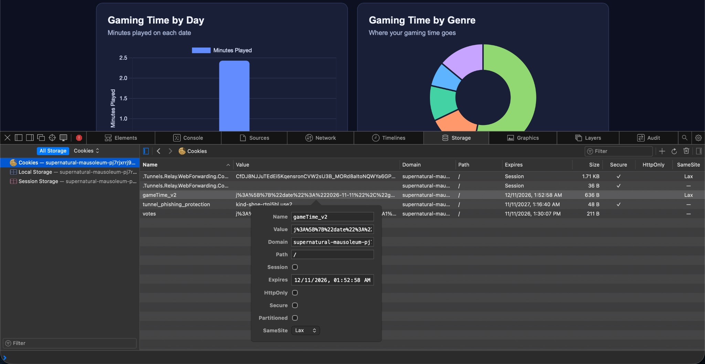

# GameTime — AI-Scripted Cookie Tracker Dashboard

🎥 **Video walkthrough (3–5 minutes):** [https://www.youtube.com/watch?v=9R_sm-qdoyY]

**Course:** CIM 343/643 — Front End Fundamentals  
**Repository:** [FF-Express-Fall-26](https://github.com/Jkr81/FF-Express-Fall-26)

## What I tracked and why

GameTime tracks time spent playing video games. I wanted a tracker where I could enter a game's name, choose its genre, start a timer, and save the session when I finished. Each entry records the date, game, genre, and minutes played. I can then see my gaming habits in a dashboard instead of looking through individual entries.

The dashboard shows total playtime, number of sessions, and the most-played genre. It also includes a Chart.js bar chart for minutes played by date, a Chart.js doughnut chart for minutes by genre, and a p5.js arcade where each saved session becomes a machine.

**Tools:** HTML, CSS, JavaScript, Node.js, Express, `cookie-parser`, `fetch()`, Chart.js, p5.js, and GitHub Codespaces.

## Version 1 — First AI-generated result

**[Read my v1 prompt](tracker-docs/prompt-v1.md)**

**Timer:** `/tracker/v1`  
**Dashboard:** `/tracker/v1/dashboard`









### What worked and what didn't

I tested v1 with sessions including Minecraft (Sandbox) and Fortnite (Shooter). The timer saved the entries, the dashboard calculated playtime and genre information, and the charts responded to the saved data. Clearing the data also worked during testing.

There were some presentation and reliability issues. The arcade machines were small and grouped toward the left, and they didn't show the game name or session duration. Chart labels were also dim and difficult to read. On some refreshes, the arcade machines temporarily disappeared, and navigating back to the timer sometimes failed until I refreshed again.

## Version 2 — Final version

**[Read my v2 test log and revised prompt](tracker-docs/prompt-v2.md)**

**Timer:** `/tracker/v2`  
**Dashboard:** `/tracker/v2/dashboard`











### What improved

In v2, the chart labels are brighter and easier to read. The arcade machines are larger, centered, and labeled with each game's name, genre, and session length. The timer also gives clearer feedback when a session is saved. I refreshed the v2 dashboard multiple times with four saved sessions; the arcade stayed visible and the navigation back to the timer worked.

I saved Minecraft twice and saw two Minecraft machines. That is expected because the sketch draws one machine **per session**, not one per unique game.

| Feature | Version 1 | Version 2 |
| --- | --- | --- |
| Timer | Saves gaming sessions | Clearer saved-session feedback |
| Chart labels | Dim and harder to read | Brighter and more legible |
| Arcade layout | Small machines toward the left | Larger, centered machines |
| Machine labels | Genre only | Game name, genre, and minutes |
| Refresh | Sometimes hid the arcade temporarily | Arcade remained visible in repeated tests |
| Navigation | Sometimes needed a refresh | Worked in repeated tests |
| Cookie | `gameTime_v1` | `gameTime_v2` |

### Test log

| Test | Result |
| --- | --- |
| Save Minecraft in v1 | Passed — session appeared in the dashboard |
| Save Fortnite in v1 | Passed — dashboard charts updated |
| Refresh v1 repeatedly | Intermittent issue — arcade sometimes disappeared |
| Navigate from v1 dashboard | Intermittent issue — timer link sometimes failed |
| Save Minecraft, Fortnite, and Legend of Zelda in v2 | Passed — entries appeared in charts and arcade |
| Save Minecraft a second time | Passed — separate machine appeared for the separate session |
| Refresh v2 with four entries | Passed — all four machines remained visible |
| Navigate back to v2 timer | Passed — navigation continued working |
| Display five sessions in v2 | Passed — five arcade machines and updated charts appeared |
| Inspect v2 cookie in Safari | Passed — `gameTime_v2` cookie contained saved session data |
| Clear all v2 data | Passed — all saved sessions were removed, and the charts and arcade cleared |
| Submit invalid/empty input | Passed — invalid or empty entries were rejected and not saved |

The v2 dashboard showed four sessions totaling approximately **2.5 minutes**, with Shooter as the top genre during that test.

### Hand edits

After testing v2, I adjusted the p5.js arcade machine height calculation because the differences between shorter gaming sessions were difficult to see. This makes the height changes more noticeable based on how long each session lasted.

## How my code works

### 1. Saving the cookie

From `app.js`:

```js
app.post("/tracker/v2/save", (req, res) => {
  const game = typeof req.body.game === "string" ? req.body.game.trim() : "";
  const genre = req.body.genre;
  const date = req.body.date;
  const minutes = Number(req.body.minutes);

  const allowedGenres = [
    "Action", "Adventure", "RPG", "Shooter", "Sports",
    "Racing", "Simulation", "Strategy", "Sandbox", "Other"
  ];

  if (!game || game.length > 60 || !allowedGenres.includes(genre) ||
      typeof date !== "string" || !/^\d{4}-\d{2}-\d{2}$/.test(date) ||
      !Number.isFinite(minutes) || minutes <= 0) {
    return res.status(400).json({ message: "Invalid gaming session" });
  }

  let sessions = req.cookies.gameTime_v2 || [];
  if (!Array.isArray(sessions)) sessions = [];

  sessions.push({ date, game, genre, minutes });
  sessions = sessions.slice(-30);

  res.cookie("gameTime_v2", sessions, {
    maxAge: 30 * 24 * 60 * 60 * 1000,
    sameSite: "lax"
  });

  res.json({ message: "Session saved successfully" });
});
```

When someone clicks stop and save, GameTime sends all the information input (name, genre, and time) to the server with a POST request. Then when you navigate to the dashboard the GET request is used to retrieve your saved sessions. Express routes support this by telling the server what to do when something is requested by the website.

### 2. Getting the data to the dashboard

From `app.js`:

```js
app.get("/tracker/v2/data", (req, res) => {
  const sessions = req.cookies.gameTime_v2 || [];
  res.json(Array.isArray(sessions) ? sessions : []);
});
```

Here GameTime uses cookies instead of keeping them in javascript variables because if kept in those variables, then it will disappear when you refresh the page. My cookie here is the gameTime_v2 which saves my information each session which can be later retrieved.

### 3. Chart 1 — Minutes played by date

From `public/tracker/v2/js/dashboard.js`:

```js
const totals = sumBy(sessions, "date");
const dates = Object.keys(totals).sort();

// Inside the Chart.js configuration:
labels: dates,
datasets: [{
  label: "Minutes Played",
  data: dates.map(date => totals[date]),
  backgroundColor: "#638cff",
  borderRadius: 7,
  maxBarThickness: 65
}]
```

Here Chart.js doesn't collect gaming sessions, instead it takes the information that GameTime has saved and turns that into visual graphs. This Chart.js is a javascript library that creates these charts from data. The bar chart is made by the minutes played on each date and shows the playtime for that day.

### 4. p5.js arcade sketch

From `public/tracker/v2/js/sketch.js`:

```js
const duration = Number(session.minutes) || 0;
const extraHeight = p.map(p.constrain(duration, 0, 5), 0, 5, 0, 45);
const cabinetHeight = 102 + extraHeight;
const cabinetColor = colors[session.genre] || colors.Other;
```

Here p5.js is also another javascript library used for creating the visual experiences I call “arcade machines.” Each machine represents a different session played, so there could be two sessions with the same game if played twice. The machines also have different colors based on genre and different height based on the amount of time played.

## Something the AI got wrong

The first generated version technically tracked sessions, but the arcade was too small to communicate much information, and refreshing sometimes caused the visualization to disappear. I learned that a working feature is not always a usable or reliable feature. For the second prompt, I described the problems more specifically rather than just asking for a better design.

## Running the project

```bash
npm install
npm start
```

Open the forwarded port 3000 in Codespaces and visit:

- **v1 timer:** `/tracker/v1`
- **v1 dashboard:** `/tracker/v1/dashboard`
- **v2 timer:** `/tracker/v2`
- **v2 dashboard:** `/tracker/v2/dashboard`

Both versions are kept in the same Express repository. Their cookies are separate so testing v2 does not overwrite v1 session data. The other Express class routes remain in the project.

## Reflection

This assignment showed me why testing an AI-generated app matters. In v1, saving sessions and displaying charts worked, but I still found issues by refreshing, navigating, and looking at the dashboard with real entries. My second prompt was more specific about what I wanted to change. Comparing the two versions made it easier to see how prompt details affect the final result.

## Final submission checklist

- [x] v1 and v2 code committed and pushed
- [x] Both prompts saved in `tracker-docs/`
- [x] Eight original screenshots added to `tracker-docs/images/`
- [x] New v2 dashboard screenshot showing **at least five entries**
- [x] Screenshot of the v2 cookie in browser DevTools
- [x] Test clear and invalid input in v2; update the test log
- [x] Write code explanations in **my own words**
- [x] Confirm hand-edit statement is accurate
- [x] All four required Express routes work
- [x] Add the **3–5-minute narrated video link at the top**
- [x] Open the README on GitHub and confirm images display
